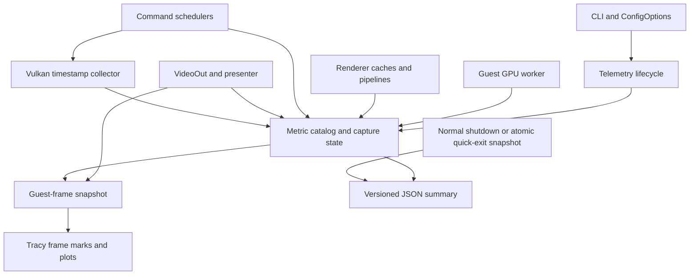
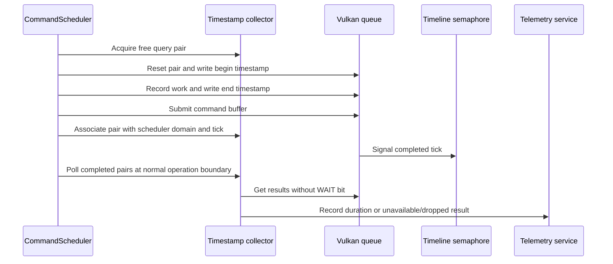
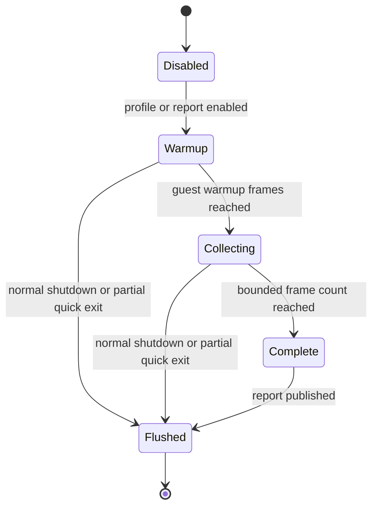

# Gameplay Performance Telemetry - Plan

## Goal Capsule

- **Objective:** KytyPS5 developers can locate gameplay bottlenecks and compare performance across repeatable runs before changing renderer behavior.
- **Means:** Add opt-in release-safe counters, CPU timing, non-blocking Vulkan timestamps, Tracy projections, and versioned JSON run summaries (KTD1-KTD6).
- **Authority:** Product Requirements govern observable behavior; Key Technical Decisions govern implementation; Vulkan query rules govern GPU timestamp validity.
- **Execution profile:** Code changes with characterization-first coverage around aggregation, shutdown, scheduler timing, and unsupported-device behavior.
- **Stop conditions:** Stop if instrumentation requires a new GPU wait, if quick-exit reporting accesses live graphics objects, or if a metric cannot be named without implying causal frame attribution the implementation cannot prove.
- **Completion owner:** Implementer completes code, tests, and documentation; a maintainer validates overhead and report usefulness with one supported title on representative hardware.

---

## Product Contract

### Summary

Add a disabled-by-default telemetry path that measures gameplay-relevant CPU and GPU work, exposes live values in Tracy, and writes comparable machine-readable summaries when requested.
Telemetry must remain usable in release builds without turning unsupported GPU timing or output failures into emulator failures.

### Problem Frame

Current Tracy zones expose selected CPU activity, but KytyPS5 has no Vulkan timestamp collection, stable frame-level metric model, or run artifact for regression comparison.
Shader compilation, synchronization, transfers, descriptor churn, garbage collection, and presentation can all cause gameplay stalls, yet current evidence cannot rank them consistently.
Without a shared measurement contract, optimization work risks moving cost rather than reducing it.

### Key Decisions

- **Opt-in telemetry remains compiled into release builds.** `(session-settled: user-approved — chosen over debug-only instrumentation: real gameplay and driver behavior must be measurable in shipping-equivalent builds.)` Governs R1 and R2.
- **Each capture can produce a machine-readable summary as well as Tracy data.** `(session-settled: user-approved — chosen over Tracy-only manual inspection: regression comparisons need durable, tool-independent artifacts.)` Governs R3, R4, and R9.
- **This phase supplies capture plumbing and representative scenarios, not a large game-specific fixture library.** `(session-settled: user-approved — chosen over bundling title-specific replay fixtures now: telemetry contracts must stabilize before fixture expansion.)` Governs R10 and R11.

### Requirements

**Activation and lifecycle**

- R1. Telemetry code is available in release builds and defaults off for both direct emulator and launcher-driven runs.
- R2. Disabled telemetry creates no Vulkan query resources, reads no clocks, updates no metric atomics, and writes no report.
- R3. `--performance-report <path>` enables collection and requests a JSON report independently of `--profile`; `--profile` enables Tracy projection without requiring a report.
- R4. Optional warm-up and capture-frame limits create a repeatable measurement window; zero capture frames means collect until shutdown.
- R5. Normal destruction finalizes a complete report after graphics drains; `std::quick_exit` atomically closes collection and emits an explicitly partial report without accessing live graphics objects.

**Measurement model**

- R6. A successful guest flip defines a gameplay frame boundary; repeated, blank, paused, and overlay-only presents remain separate counters and do not enter gameplay frame percentiles.
- R7. Frame samples report deltas observed between guest-present boundaries and must not claim exact causal ownership of asynchronously completed work.
- R8. Telemetry covers frame intervals, GPU-worker processing, draws and dispatches, queue submissions, scheduler waits, barriers, shader and pipeline compilation, descriptor activity, uploads and readbacks, stream-buffer pressure, garbage collection, and presentation.
- R9. GPU timing measures recorded command-buffer execution with Vulkan timestamp queries without adding host waits; unsupported timing and dropped samples remain visible in output.

**Output and workflow**

- R10. Each JSON report carries a schema version, build and host-GPU metadata, capture configuration, frame classifications, metric units, counts, totals, minima, maxima, means, p50/p95/p99 values, and dropped or unsupported sample counts.
- R11. Documentation defines idle, cold-start, warm-gameplay, draw-heavy, compute-heavy, upload-heavy, readback-heavy, and presentation-focused capture scenarios without committing title-specific assets to this phase.
- R12. Tracy receives one frame mark per successful guest presentation plus named plots for stable aggregate metrics when profiling is active.

### Acceptance Examples

- AE1. Given neither `--profile` nor `--performance-report`, when gameplay renders, then no telemetry report or Vulkan query pool exists and gameplay behavior remains unchanged.
- AE2. Given `--performance-report run.json --performance-warmup-frames 120 --performance-capture-frames 600`, when 720 guest frames have presented, then the report covers exactly the last 600 guest frames and further frames do not change the completed capture.
- AE3. Given a queue family with no timestamp support, when report capture runs, then CPU counters and frame summaries remain valid while GPU timing is marked unsupported.
- AE4. Given timestamp slots are exhausted, when another command buffer is submitted, then submission proceeds without waiting and the report increments a dropped-GPU-sample counter.
- AE5. Given the window closes through the current quick-exit path while guest threads may still run, when emergency telemetry finalization executes, then one parseable report marked `quick_exit_partial` is published without touching graphics state, or one non-fatal output warning is logged.

### Success Criteria

- A warm gameplay report identifies whether CPU frame work, GPU submission work, compilation, synchronization, transfer, garbage collection, or presentation dominates the capture.
- Repeating the same capture window produces schema-compatible JSON that external tooling can compare without parsing log text.
- Telemetry adds no new Vulkan or timeline wait on any enabled or disabled path.
- Disabled instrumentation adds only predictable enable checks at instrumented boundaries and performs no allocations, clock reads, atomic metric updates, or file I/O.
- On one documented warm draw-heavy capture, report-only telemetry changes median CPU frame time by no more than 3% and p95 CPU frame time by no more than 5% across five alternating baseline/capture runs; results and hardware are recorded in implementation validation notes.

### Scope Boundaries

**In scope**

- Emulator CLI configuration, telemetry lifecycle, CPU counters and histograms, Vulkan timestamp collection, Tracy frame marks and plots, JSON summaries, tests, and capture documentation.
- Instrumentation at existing ownership boundaries rather than renderer redesign.

**Deferred to Follow-Up Work**

- Automated title-specific PM4, shader, and gameplay replay fixtures.
- CI performance thresholds and historical trend dashboards.
- In-emulator performance overlays and launcher UI for report configuration.

**Outside this phase**

- Shader-cache implementation, barrier narrowing, queue splitting, descriptor caching, stream-buffer resizing, garbage-collector redesign, or direct-present optimization.
- Per-draw Vulkan timestamp zones; submission timing provides bounded overhead for the first telemetry phase.
- Raw unbounded event logs; aggregate reports avoid memory growth and high-cardinality output.

---

## Planning Contract

### Key Technical Decisions

- KTD1. **Use one process-wide telemetry service with a fixed metric catalog.** `(session-settled: user-approved — chosen over debug-only or subsystem-local collectors: release captures need one comparable report with bounded ownership.)` Call sites first test a cached enabled state, then update relaxed atomic counters or fixed-bucket duration histograms. Normal finalization consumes drained graphics metadata; quick-exit finalization first disables producers and snapshots only process-owned atomics. Covers R1-R5 and R8.
- KTD2. **Use successful guest presentation as the sampling boundary.** Presentation code publishes one classified boundary, while the collector snapshots deltas accumulated since the prior guest frame. Asynchronous GPU results retain scheduler-domain and submit-tick identity instead of being falsely assigned to a frame. Covers R6, R7, and R12.
- KTD3. **Own Vulkan timestamp queries inside the command scheduler.** A bounded query-pair pool writes begin/end timestamps around each recorded command buffer, associates the pair with the scheduler timeline tick, and polls only after that tick is free. This supports JSON output directly and avoids coupling report correctness to Tracy internals. Covers R2 and R9.
- KTD4. **Project stable aggregates into Tracy rather than making Tracy the data store.** Existing CPU zones remain; frame boundaries emit `FrameMark`, and the telemetry service emits named plots at guest-frame cadence only when `tracy::ProfilerAvailable()` is true. Covers R3 and R12.
- KTD5. **Publish a versioned aggregate JSON document atomically.** `(session-settled: user-approved — chosen over Tracy-only output: automated regressions need durable summaries independent of profiler sessions.)` Write a sibling temporary file, flush and close it, then replace the destination. Output failure logs once and never terminates emulation. Covers R3, R5, and R10.
- KTD6. **Use an explicit capture-window state machine.** Warm-up counts only successful guest frames; collection freezes after the requested sample count; unlimited captures finalize during shutdown. A completed bounded capture writes immediately and finalization becomes a no-op. Covers R4-R6.
- KTD7. **Classify waits and work at existing ownership points.** Scheduler waits carry a small reason enum; renderer boundaries record counts, bytes, and durations without wrapping individual PM4 packets or Vulkan calls in dynamic allocations. Covers R2 and R8.

### High-Level Technical Design

#### Component and data flow

The telemetry service accepts monotonic counters and duration observations from multiple threads.
Only presentation advances frame-window state, while shutdown owns the final report fallback.

#### GPU timestamp lifecycle

The collector checks queue-family `timestampValidBits`, applies the physical device `timestampPeriod`, and handles valid-bit wrapping.
It never calls a wait to recover telemetry.

#### Capture state lifecycle

A no-report Tracy session still uses the same state but skips file publication.
A quick-exit transition freezes atomics and marks pending GPU data incomplete; it never queries or destroys graphics resources.
An output error ends publication, not emulation.

#### Activation matrix

| `--profile` | `--performance-report` | CPU metrics | GPU timestamps | Tracy | JSON |
|---|---|---|---|---|---|
| Off | Absent | Off | Off | Off | None |
| On | Absent | On | On when supported | On | None |
| Off | Present | On | On when supported | Off | Written |
| On | Present | On | On when supported | On | Written |

### Metric Catalog

Metric names and units form part of JSON schema version 1.
New metrics may be added compatibly; renaming, unit changes, or semantic changes require a schema-version increment.

| Concern | Required observations |
|---|---|
| Frames | guest frames, repeated/blank/paused/overlay-only presents, guest-frame interval, presentation CPU duration, missed or late vblank opportunities |
| Guest GPU | queued/completed submissions, queue-depth high-water mark, PM4 processing CPU duration, synchronous command-lane calls |
| Rendering | draw and dispatch counts, command-buffer submissions, dynamic-rendering begin/end count, barrier count by resource category |
| Compilation | shader translation/compile count and duration, permutation hits/misses, graphics/compute pipeline creation count and duration |
| Descriptors | descriptor commits, push-descriptor uses, set allocations, pool creations/resets/rollovers |
| Memory movement | upload/download ranges and bytes, temporary upload fallbacks, image copies, stream wraps and waits |
| Synchronization | timeline wait count and duration by reason, priority-operation waits, frame-pool reuse waits |
| Collection | GPU submission duration by guest/presentation scheduler, unsupported timing, query exhaustion, unavailable results |
| Maintenance | buffer/texture GC duration, scanned/retired resources, downloaded bytes, memory-pressure mode |

### Sequencing

1. Establish metric schema, capture state, configuration, and shutdown ownership before adding hot-path producers.
2. Add frame boundaries and Tracy projection so every later metric can be observed in context.
3. Instrument scheduler waits and guest-GPU processing with characterization coverage before adding GPU queries.
4. Add Vulkan timestamps and unsupported/exhaustion behavior using the existing Vulkan harness.
5. Instrument rendering, compilation, descriptors, transfers, and garbage collection against the stable catalog; these ownership-specific units can proceed independently.
6. Document and run representative captures after schema and timing behavior stabilize.

### System-Wide Impact

- **Users:** No behavior changes unless profiling or report capture is requested; report paths become new host-side output.
- **Developers:** Tracy gains stable frame marks and plots; JSON gives reviewable run artifacts and metric semantics.
- **Renderer:** Hot paths gain gated counter and timer calls but no new synchronization.
- **Lifecycle:** Telemetry initializes after config; normal shutdown finalizes after graphics drains, while `std::quick_exit` writes an atomic partial snapshot because current graphics lifecycle has no emergency-shutdown callback.
- **Compatibility:** Unsupported Vulkan timestamps degrade to CPU-only reports rather than reducing game compatibility.
- **Storage:** Reports contain title/build/device metadata and aggregate timing only; no guest memory contents, shader code, or file paths beyond the user-selected report destination.

### Risks and Mitigations

| Risk | Mitigation |
|---|---|
| Instrumentation changes frame timing | Keep disabled path branch-only, aggregate into fixed buckets, emit Tracy plots once per guest frame, and enforce the documented overhead check. |
| Query reuse races GPU completion | Recycle pairs only after the scheduler timeline tick is free and query availability is confirmed. |
| Query capacity is exhausted | Drop the sample, increment a counter, and never wait or allocate in response to pressure. |
| Timestamps are unsupported or wrap | Check queue-family valid bits, mask subtraction correctly, and expose unsupported/invalid counts. |
| Frame deltas imply false causality | Label samples as between-presentation observations and keep GPU samples identified by scheduler domain and tick. |
| Quick-exit races live graphics work | Disable telemetry producers atomically, snapshot only collector-owned atomics, mark pending GPU samples incomplete, and never access scheduler or Vulkan objects from the quick-exit callback. |
| Output failure crashes a run | Treat create/write/rename failures as one logged warning and preserve emulator shutdown. |
| Schema drift breaks comparison tools | Version the schema and test field names, units, and required metadata. |
| Large captures consume unbounded memory | Store aggregate counters and fixed histograms; do not retain raw events or every frame sample. |

### Alternative Approaches Considered

- **Use Tracy Vulkan GPU zones as the sole GPU timing source:** Rejected because machine-readable summaries still need independent aggregation, and report correctness would depend on Tracy session state and pinned API details.
- **Measure GPU work from CPU submit-to-completion time:** Rejected because queueing and host scheduling would be mislabeled as GPU execution.
- **Timestamp every draw and dispatch:** Deferred because query pressure and command overhead conflict with Phase 1's low-overhead goal; submission timing is sufficient to rank first-order stalls.
- **Write JSON Lines for every event:** Rejected because hot-path serialization, storage growth, and high cardinality would distort captures.
- **Add a separate benchmark executable now:** Rejected because representative gameplay requires emulator state and real presentation; the current executable with bounded capture windows provides the needed integration surface.

### Sources and Research

- `src/common/profiler.h` and `src/common/profiler.cpp` establish on-demand Tracy startup and CPU-zone conventions.
- `src/graphics/host_gpu/renderer/commandScheduler.cpp` and `masterSemaphore.cpp` establish command-buffer submission, timeline ticks, waits, and deferred completion ownership.
- `src/graphics/presentation/videoOut.cpp` and `src/graphics/presentation/window/swapchain.cpp` establish vblank, guest flip, prepared-frame, and successful presentation boundaries.
- `src/emulator.cpp` establishes reverse subsystem teardown and the `std::quick_exit` path that report finalization must survive.
- Vulkan query specification: <https://docs.vulkan.org/spec/latest/chapters/queries.html>.
- Khronos timestamp query sample: <https://docs.vulkan.org/samples/latest/samples/api/timestamp_queries/README.html>.
- Tracy Vulkan API reference, considered but not selected as report storage: <https://github.com/wolfpld/tracy/blob/master/public/tracy/TracyVulkan.hpp>.

### Dependencies and Prerequisites

- Install a supported Clang toolchain and Ninja before implementation verification; current environment has CMake but no `ninja`, `clang`, `clang++`, or `clang-cl`.
- Initialize repository submodules before building so Tracy, Vulkan headers, and other pinned dependencies are present.
- Use a Vulkan 1.3 device or software driver for U4 integration tests; CPU-only telemetry tests do not require timestamp support.

---

## Implementation Units

### U1. Telemetry core, capture contract, and configuration

- **Goal:** Provide bounded, thread-safe aggregation and reliable report lifecycle before renderer call sites depend on it.
- **Requirements:** R1-R5, R7, R10; AE1, AE2, AE5.
- **Dependencies:** None.
- **Files:**
  - Create `src/common/performanceTelemetry.h`
  - Create `src/common/performanceTelemetry.cpp`
  - Modify `src/common/emulatorConfig.h`
  - Modify `src/common/emulatorConfig.cpp`
  - Modify `src/main.cpp`
  - Modify `src/emulator.cpp`
  - Create `tests/PerformanceTelemetryTests.cpp`
  - Modify `CMakeLists.txt`
- **Approach:**
  1. Define a fixed metric catalog with counter, byte, duration, and high-water observations; attach stable names and units in one table used by snapshots, Tracy projection, and JSON serialization.
  2. Implement disabled, warm-up, collecting, complete, and flushed states per KTD1, KTD5, and KTD6 using bounded histograms and relaxed atomics.
  3. Add `--performance-report`, `--performance-warmup-frames`, and `--performance-capture-frames`; reject warm-up or bounded capture options when neither profiling nor report capture enables telemetry.
  4. Initialize telemetry after configuration and before graphics; use ordinary shutdown for a drained final report and a separate emergency callback that closes producers and snapshots collector-owned atomics only.
  5. Publish bounded captures immediately when complete, then make normal and quick-exit finalization idempotent; use temporary-file replacement and non-fatal error reporting.
  6. Add build revision, title ID, operating system, CPU, Vulkan device/driver, capture options, metric schema, and completion reason to report metadata without recording guest data.
- **Execution note:** Build aggregation and state-transition tests before wiring production call sites, because later units rely on schema and lifecycle stability.
- **Patterns to follow:** `Config::Lifecycle` and `Profiler::Lifecycle` in `src/common/emulatorConfig.h`, `src/common/profiler.h`, and subsystem ordering in `src/emulator.cpp`; `nlohmann_json` already linked by `common`.
- **Test scenarios:**
  1. Start with telemetry disabled, invoke every public observation type, and verify no capture advances and no report path is touched.
  2. Start with 2 warm-up frames and 3 capture frames, publish six guest boundaries, and verify only frames 3-5 contribute while frame 6 leaves the completed snapshot unchanged.
  3. Record known duration values and verify count, total, min, max, mean, and p50/p95/p99 bucket selection.
  4. Update counters concurrently from several threads and verify final totals and high-water values without lost updates.
  5. Finalize concurrently through normal and emergency entry points and verify one report wins, with `complete` or `quick_exit_partial` completion reason matching the winning path.
  6. Simulate quick exit with pending GPU samples and verify the report marks them incomplete without invoking a graphics callback.
  7. Target an unwritable or invalid destination and verify one warning result with no fatal exit.
  8. Parse valid and invalid CLI combinations, including zero limits, missing values, and numeric overflow.
  9. Verify bounded storage use does not scale with observed event count.
- **Verification:** Unit tests prove deterministic aggregation, capture-window behavior, CLI validation, idempotent finalization, and JSON schema stability; report fixtures parse with `nlohmann_json`.

### U2. Gameplay frame boundaries and Tracy projection

- **Goal:** Define trustworthy frame cadence and expose stable live telemetry without conflating guest frames with repeated or synthetic presents.
- **Requirements:** R6, R7, R12; AE2.
- **Dependencies:** U1.
- **Files:**
  - Modify `src/common/profiler.h`
  - Modify `src/common/profiler.cpp`
  - Modify `src/graphics/presentation/videoOut.cpp`
  - Modify `src/graphics/presentation/window/swapchain.cpp`
  - Modify `src/graphics/presentation/window/window.cpp`
  - Modify `tests/PerformanceTelemetryTests.cpp`
  - Modify `CMakeLists.txt`
- **Approach:**
  1. Classify presentation outcomes as guest, repeat, blank, paused, or overlay-only at the point where `Presenter::Impl::Present` succeeds and where `FlipQueue::Flip` knows whether a guest group was due.
  2. Advance telemetry capture only for successful guest frames; count every other class separately and record presentation CPU work and guest-frame interval.
  3. Emit one Tracy frame mark for each successful guest frame and publish fixed-name plots from the completed frame snapshot, not from arbitrary producer threads.
  4. Preserve current FPS title behavior while sourcing optional diagnostic values from the same classified counters to prevent competing frame definitions.
- **Patterns to follow:** `KYTY_PROFILER_BLOCK` in `FlipQueue::Flip`, `Presenter::Impl::Present`, `Profiler::SetThreadName`, and `window.loop.presented_frames` ownership.
- **Test scenarios:**
  1. Publish guest, repeat, blank, paused, and overlay-only outcomes and verify only the guest outcome increments capture-frame count.
  2. Publish a failed or dropped presentation attempt and verify it does not emit a frame boundary.
  3. Enable report capture without Tracy and verify frame aggregation runs without Tracy calls.
  4. Enable Tracy without a report and verify capture state and plots run without creating a report file.
  5. Complete a bounded capture and verify later presentation outcomes do not mutate the frozen report.
  6. Verify two frame-boundary calls from different presentation paths cannot count one presented guest group twice.
- **Verification:** Synthetic frame classification tests match KTD2 and KTD6; a Tracy smoke capture shows one frame mark per guest flip and stable plot names.

### U3. Guest-GPU work and scheduler wait instrumentation

- **Goal:** Measure command-lane pressure, submission processing, and host waits without changing scheduler ordering.
- **Requirements:** R2, R7, R8, R10; AE1.
- **Dependencies:** U1 and U2.
- **Files:**
  - Modify `src/graphics/guest_gpu/graphicsRun.cpp`
  - Modify `src/graphics/host_gpu/renderer/commandScheduler.h`
  - Modify `src/graphics/host_gpu/renderer/commandScheduler.cpp`
  - Modify `src/graphics/host_gpu/renderer/masterSemaphore.h`
  - Modify `src/graphics/host_gpu/renderer/masterSemaphore.cpp`
  - Modify `src/graphics/presentation/window/swapchain.cpp`
  - Modify `tests/PerformanceTelemetryTests.cpp`
  - Modify `tests/ShaderRecompilerComputeTests.cpp`
  - Modify `CMakeLists.txt`
- **Approach:**
  1. Record guest submission queue depth, high-water mark, completed slices, blocked/resumed slices, PM4 processing CPU duration, and synchronous command-lane calls at `GuestGpu` ownership boundaries.
  2. Give timeline waits reason categories for readback, garbage collection, frame-pool reuse, finish, shutdown, priority completion, and generic scheduler use.
  3. Record wait attempts separately from actual blocked duration so already-complete ticks do not look like stalls.
  4. Count native queue submissions only after successful `vkQueueSubmit`; retain scheduler domain and tick for later GPU timing.
- **Execution note:** Add characterization assertions to existing scheduler tests before changing wait signatures or call-site labels.
- **Patterns to follow:** Scheduler timeline and command-lane coverage in `tests/ShaderRecompilerComputeTests.cpp`; `MasterSemaphore` timeline ownership.
- **Test scenarios:**
  1. Execute waits for already-free ticks and verify attempts increment while blocked duration remains zero.
  2. Block a submission on an external timeline, release it, and verify one wait with the expected reason and non-zero duration.
  3. Queue graphics, compute, and synchronous commands and verify queue-depth high-water, completed work, and command-lane counts.
  4. Suspend and resume a blocked PM4 slice and verify processing duration is counted without reporting duplicate completion.
  5. Run the scheduler fixtures with telemetry disabled and verify metric snapshots remain empty.
- **Verification:** Existing scheduler and GPU command-lane tests retain ordering; new assertions prove wait classification, queue pressure, submission counting, and disabled-path gating.

### U4. Non-blocking Vulkan GPU submission timestamps

- **Goal:** Measure guest and presentation command-buffer GPU execution without stalling either scheduler.
- **Requirements:** R2, R9, R10; AE1, AE3, AE4.
- **Dependencies:** U1 and U3.
- **Files:**
  - Create `src/graphics/host_gpu/renderer/gpuTimestampCollector.h`
  - Create `src/graphics/host_gpu/renderer/gpuTimestampCollector.cpp`
  - Modify `src/graphics/host_gpu/renderer/commandScheduler.h`
  - Modify `src/graphics/host_gpu/renderer/commandScheduler.cpp`
  - Modify `src/graphics/host_gpu/graphicContext.h`
  - Modify `src/graphics/host_gpu/vulkanCommon.cpp`
  - Modify `src/graphics/presentation/window/swapchain.cpp`
  - Modify `tests/ShaderRecompilerComputeTests.cpp`
  - Modify `CMakeLists.txt`
- **Approach:**
  1. Label command schedulers as guest-render or presentation domains so query results remain distinguishable.
  2. Create the bounded timestamp query pool only when telemetry is enabled and the selected queue family reports non-zero timestamp valid bits.
  3. Acquire a free query pair when command recording begins; record reset and begin/end timestamps in the same command buffer without changing submission waits or signals.
  4. Associate submitted pairs with the timeline tick returned by `CommandScheduler::Submit` and collect them at existing operation boundaries after `MasterSemaphore` reports completion.
  5. Request 64-bit results with availability and without the wait flag; mask valid bits, apply `timestampPeriod`, reject impossible results, and return pairs to the free list.
  6. When no pair is free or timing is unsupported, record the condition and continue submission unchanged.
  7. Drain completed results during scheduler shutdown after its existing timeline wait, then destroy query resources.
- **Execution note:** Test conversion and wrap arithmetic as pure logic first; then add Vulkan-harness coverage for lifecycle and non-blocking collection.
- **Patterns to follow:** `CommandScheduler::CommandPool` reuse by timeline tick, `MasterSemaphore::KnownGpuTick`, Vulkan 1.3 `pipelineBarrier2` conventions, and existing `VulkanHarness` scheduler tests.
- **Test scenarios:**
  1. Submit a no-op command buffer on a timestamp-capable Vulkan harness and verify one available guest-domain duration with matching submit tick.
  2. Submit through a presentation-domain scheduler and verify its sample remains separately classified.
  3. Use synthetic timestamps around the valid-bit wrap and verify positive elapsed nanoseconds after masking and scaling.
  4. Simulate zero timestamp valid bits and verify CPU telemetry remains enabled while GPU timing reports unsupported.
  5. Exhaust all query pairs with blocked submissions and verify later submissions continue, increment dropped samples, and perform no telemetry wait.
  6. Release blocked submissions, collect completed pairs, and verify slots become reusable only after completion and availability.
  7. Shut down with pending timestamp work and verify the existing scheduler drain permits safe collection and query-pool destruction.
  8. Disable telemetry and verify scheduler construction creates no query pool and records no timestamp commands.
- **Verification:** Vulkan-harness tests prove query lifecycle, domain labeling, wrap conversion, unsupported behavior, exhaustion behavior, and zero added waits; validation layers report no query-reset or reuse errors.

### U6. Draw, dispatch, and barrier instrumentation

- **Goal:** Count native render work and synchronization categories without changing Vulkan commands.
- **Requirements:** R2, R7, R8, R10; AE1.
- **Dependencies:** U1 and U2.
- **Files:**
  - Modify `src/graphics/guest_gpu/graphicsRun.cpp`
  - Modify `src/graphics/host_gpu/renderer/renderDraw.cpp`
  - Modify `src/graphics/host_gpu/renderer/renderCompute.cpp`
  - Modify `src/graphics/host_gpu/renderer/pipeline/shaderResourceBarrier.cpp`
  - Modify `src/graphics/host_gpu/renderer/cache/bufferCache.cpp`
  - Modify `src/graphics/host_gpu/renderer/cache/faultManager.cpp`
  - Modify `src/graphics/host_gpu/renderer/cache/streamBuffer.cpp`
  - Modify `src/graphics/host_gpu/renderer/cache/textureCache.cpp`
  - Modify `src/graphics/host_gpu/renderer/image/image.cpp`
  - Modify `src/graphics/host_gpu/renderer/image/tiler.cpp`
  - Modify `src/graphics/presentation/window/swapchain.cpp`
  - Modify `tests/ShaderRecompilerComputeTests.cpp`
  - Modify `CMakeLists.txt`
- **Approach:**
  1. Count native draws and dispatches only at Vulkan emission points; skipped or unsupported guest operations remain separate counters.
  2. Count dynamic-rendering begin/end transitions and barriers by shader, buffer, image, global, and presentation category at current barrier ownership sites.
  3. Preserve every stage mask, access mask, render-pass split, and command order; instrumentation observes commands but never coalesces them.
- **Patterns to follow:** Existing render executor tests and Vulkan command recording in `renderDraw.cpp`, `renderCompute.cpp`, and `shaderResourceBarrier.cpp`.
- **Test scenarios:**
  1. Emit indexed, automatic, and skipped draws and verify only native draw commands increment emitted-work counters.
  2. Emit direct and indirect dispatches and verify each successful native dispatch is counted once.
  3. Exercise shader, buffer, image, global, and presentation barriers and verify category totals without changing expected image layouts or scheduler ticks.
  4. Run the same fixtures with telemetry disabled and verify no observations are stored.
- **Verification:** Existing draw, compute, image-layout, and scheduler fixtures retain command results; telemetry assertions match emitted Vulkan work exactly once.

### U7. Shader, pipeline, and descriptor instrumentation

- **Goal:** Separate compilation hitches, cache behavior, and descriptor churn in frame summaries.
- **Requirements:** R2, R7, R8, R10; AE1.
- **Dependencies:** U1 and U2.
- **Files:**
  - Modify `src/graphics/host_gpu/renderer/pipeline/pipelineCache.cpp`
  - Modify `src/graphics/host_gpu/renderer/pipeline/shaders.cpp`
  - Modify `src/graphics/host_gpu/renderer/pipeline/descriptors.cpp`
  - Modify `src/graphics/host_gpu/renderer/pipeline/descriptorHeap.cpp`
  - Modify `tests/PerformanceTelemetryTests.cpp`
  - Modify `tests/ShaderRecompilerComputeTests.cpp`
  - Modify `CMakeLists.txt`
- **Approach:**
  1. Measure guest shader translation and SPIR-V compilation separately from graphics and compute pipeline creation.
  2. Record program permutation hits, misses, and creations without changing cache keys or lifetime.
  3. Record descriptor commits, push-descriptor use, set allocation, batch reuse, pool creation, reset, and rollover at existing heap boundaries.
- **Patterns to follow:** Existing profiler scopes around pipeline creation and descriptor-heap batch allocation.
- **Test scenarios:**
  1. Exercise a shader/program miss followed by a hit and verify compilation duration occurs only on the miss.
  2. Exercise graphics and compute pipeline misses followed by hits and verify creation counts and durations remain separate.
  3. Reuse descriptor batches and force pool rollover, then verify allocation, reuse, rollover, reset, and creation counters.
  4. Enable shader validation and debug dumping and verify their work does not change compile-event identity or double-count compilation.
  5. Run all fixtures with telemetry disabled and verify no observations are stored.
- **Verification:** Pipeline and descriptor fixtures preserve cache behavior; telemetry distinguishes translation, module compilation, pipeline creation, cache reuse, and pool churn.

### U8. Transfer, stream-buffer, and garbage-collection instrumentation

- **Goal:** Expose memory movement, ring pressure, and maintenance stalls without retaining guest addresses.
- **Requirements:** R2, R7, R8, R10; AE1.
- **Dependencies:** U1-U3.
- **Files:**
  - Modify `src/graphics/host_gpu/renderer/renderContext.cpp`
  - Modify `src/graphics/host_gpu/renderer/cache/streamBuffer.cpp`
  - Modify `src/graphics/host_gpu/renderer/cache/bufferCache.cpp`
  - Modify `src/graphics/host_gpu/renderer/cache/textureCache.cpp`
  - Modify `src/graphics/host_gpu/renderer/cache/faultManager.cpp`
  - Modify `src/graphics/host_gpu/renderer/image/image.cpp`
  - Modify `tests/PerformanceTelemetryTests.cpp`
  - Modify `tests/ShaderRecompilerComputeTests.cpp`
  - Modify `CMakeLists.txt`
- **Approach:**
  1. Record upload/download range counts and bytes, image-copy bytes where calculable, and temporary staging fallback use without serializing addresses.
  2. Record stream reservations, wraps, rejected non-waiting reservations, actual reuse waits, and high-water occupancy.
  3. Measure buffer and texture garbage collection separately, including scanned and retired resources, dirty downloads, and normal versus aggressive mode.
  4. Reuse U3 wait reasons for readback and garbage-collection stalls instead of creating a second timing source.
- **Execution note:** Characterize stream-ring and dirty-GC behavior before adding observations because both paths can submit and wait recursively.
- **Patterns to follow:** Existing stream-ring, buffer-cache range, and dirty-GC fixtures in `tests/ShaderRecompilerComputeTests.cpp`.
- **Test scenarios:**
  1. Exercise stream wrap with and without `allow_wait` and verify wrap, rejection, occupancy, and actual wait counts remain distinct.
  2. Upload and download known ranges and verify byte totals, range counts, and temporary staging fallback classification.
  3. Execute image upload, download, and copy operations and verify transfer categories without exposing source addresses.
  4. Run clean and dirty garbage collection paths and verify durations, scanned/retired resources, dirty bytes, and pressure mode.
  5. Run transfer and GC fixtures with telemetry disabled and verify no observations are stored.
- **Verification:** Existing stream, buffer-cache, texture-cache, image-transfer, and GC tests retain behavior; recorded counts and bytes match fixture inputs.

### U5. Capture workflow, schema documentation, and overhead validation

- **Goal:** Make telemetry reproducible for maintainers and establish a baseline protocol for later optimization phases.
- **Requirements:** R10-R12.
- **Dependencies:** U1-U4 and U6-U8.
- **Files:**
  - Create `docs/performance.md`
  - Modify `README.md`
  - Modify `src/main.cpp`
  - Modify `CMakeLists.txt`
- **Approach:**
  1. Document CLI activation, warm-up/capture semantics, output failure behavior, frame classifications, metric names, units, percentile approximation, schema-version policy, and privacy boundaries.
  2. Define repeatable idle, cold-start, warm-gameplay, draw-heavy, compute-heavy, upload-heavy, readback-heavy, and presentation-focused scenarios with fixed route, settings, vblank mode, cache state, warm-up, sample count, and hardware/driver metadata.
  3. Define an alternating baseline/capture overhead protocol across five runs and require median and p95 comparison against the Success Criteria.
  4. Add focused CTest registrations for telemetry aggregation and Vulkan timestamp behavior so contributors can validate Phase 1 without running the full shader suite manually.
  5. Include example JSON field shapes without committing volatile measured values as golden documentation.
- **Patterns to follow:** Build and regression-test commands already documented in `README.md`; registered test naming in `CMakeLists.txt`.
- **Test expectation:** None for prose itself; CLI help and focused CTest registrations are covered by U1 and U4 tests.
- **Verification:** A maintainer unfamiliar with implementation can run one bounded capture, identify capture completeness or dropped samples, compare two JSON reports, and reproduce the documented overhead check.

---

## Verification Contract

| Gate | Applies to | Verification |
|---|---|---|
| Telemetry unit tests | U1-U3, U7-U8 | Build `performance_telemetry_tests`; verify aggregation, state transitions, concurrency, report output, metric producers, and disabled behavior. |
| Scheduler timestamp tests | U3-U4 | Run focused `command_scheduler_timeline` and new GPU timestamp CTest entries through the Vulkan harness. |
| Renderer metric tests | U6-U8 | Run focused draw, compute, image-layout, stream-buffer, pipeline, descriptor, transfer, and GC fixtures. |
| Full regression suite | U1-U8 | Build `kyty_tests`, then run `ctest --test-dir <build-dir> --output-on-failure`. |
| Static analysis | U1-U4, U6-U8 | Build using repository Clang configuration and preserve existing clang-tidy/IWYU gates. |
| Vulkan validation | U4, U6, U8 | Run timestamp and renderer tests with Vulkan validation enabled; accept no query lifecycle, reset, availability, barrier, or destruction errors. |
| Disabled smoke | U1-U4, U6-U8 | Run emulator without telemetry flags; verify no report, query resources, telemetry allocations, or changed gameplay behavior. |
| Tracy smoke | U2-U4, U6-U8 | Run with `--profile`; verify guest-frame marks, stable plots, guest/presentation GPU domains, and no JSON unless requested. |
| Report smoke | U1-U8 | Run a bounded report capture without Tracy; parse JSON, verify exact guest-frame count, metadata, metric units, and completion reason. |
| Overhead acceptance | U5 | Run five alternating baseline/report-only warm captures on one supported title; meet the 3% median and 5% p95 CPU frame-time limits and observe no added GPU wait. |

Runtime validation requires a supported Clang/Ninja/CMake toolchain and Vulkan 1.3 device or software driver.
This environment lacked the compiler and Ninja during planning, so implementation must perform every listed build and runtime gate rather than treating source review as verification.

---

## Definition of Done

- R1-R12 are implemented and traceable through U1-U8.
- JSON schema version 1 is documented, parsed by tests, and contains all required metadata, units, aggregates, classifications, and sample-loss indicators.
- Guest-frame, repeat, blank, paused, and overlay-only presentation paths are distinct and cannot double-count one frame.
- CPU timing and counters cover every Metric Catalog concern without retaining guest addresses or raw event streams.
- GPU timestamp collection is bounded, non-blocking, valid-bit aware, domain labeled, and safely drained.
- Normal shutdown publishes a complete report after graphics drains; quick exit publishes at most one `quick_exit_partial` report from collector-owned atomics and tolerates output failure.
- Tracy frame marks and plots work independently from JSON output.
- Disabled telemetry creates no query pool, performs no measurements, and passes existing renderer regressions.
- Focused tests and full `ctest` pass on a supported toolchain; Vulkan validation reports no timestamp misuse.
- Documented overhead capture meets the Success Criteria or the implementation is revised before merge.
- `README.md` and `docs/performance.md` let a maintainer reproduce and compare captures without reading implementation code.
- Dead-end experiments, temporary logs, raw benchmark artifacts, and abandoned instrumentation are removed from the final diff.
